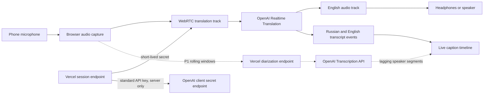

# Mobile Realtime Translation — Product and Technical Specification

Status: Draft v0.1
Date: 2026-07-24
Initial language pair: spoken Russian → spoken and written English
User language: English
Deployment: mobile web app on Vercel

## 1. Product decision

Build a listening-first mobile web app that captures nearby speech, sends the microphone track directly from the browser to OpenAI over WebRTC, and plays streamed English interpretation while showing live Russian and English captions.

Vercel serves the app and creates short-lived OpenAI client secrets. It must not proxy the realtime media path. This keeps Vercel's serverless lifecycle out of the latency-critical loop and keeps the standard OpenAI API key off the device.

The first release is strictly one-way. The product user is the English speaker and listener:

- Other people speak Russian.
- The app user hears and reads English.
- The app user replies aloud in English without translation.
- The app does not generate Russian speech for the user's reply.
- No Russian-output translation session is created.

The primary assumed setting is an in-person conversation captured by one phone microphone. A future remote-call mode may receive one audio track per participant.

## 2. Source-backed platform constraints

These constraints are treated as part of the product contract:

- Use `gpt-realtime-translate`, which is designed for continuous speech-to-speech interpretation and can emit translated audio while input speech continues.
- Connect translation sessions to `/v1/realtime/translations`; translation is continuous and does not use `response.create` or a normal assistant-turn lifecycle.
- Use WebRTC when a browser captures and plays audio. Use server-side WebSockets only for server-owned media paths such as telephony or media workers.
- Set the target with `session.audio.output.language`. Source language is detected automatically; English is a supported output and Russian is a supported input.
- Enable source transcription with `gpt-realtime-whisper` when Russian captions are required.
- Do not design around a custom prompt, glossary, fixed output voice, or voice-selection control. Realtime Translation does not currently support those controls.
- The translated voice dynamically follows the source speaker's broad tone, pitch, and speaking style. Different source speakers should therefore remain perceptibly different in translated audio, but the API does not provide a stable speaker-identity event.
- Keep participant tracks separate when they exist. A mixed stream makes speaker identity, overlapping speech, and speaker-labelled captions harder.
- `gpt-4o-transcribe-diarize` can annotate speakers, but it is available through the Transcription API, not as the realtime translation session's speaker-ID channel. It may be used as a parallel, lagging caption-enrichment path.

Authoritative references:

- [OpenAI live translation cookbook](https://developers.openai.com/cookbook/examples/voice_solutions/realtime_translation_guide)
- [OpenAI Realtime Translation guide](https://developers.openai.com/api/docs/guides/realtime-translation)
- [OpenAI Realtime Transcription guide](https://developers.openai.com/api/docs/guides/realtime-transcription)
- [OpenAI diarization model](https://developers.openai.com/api/docs/models/gpt-4o-transcribe-diarize)
- [Vercel WebSocket support](https://vercel.com/changelog/websocket-support-is-now-in-public-beta)

## 3. Goals

### P0 — first usable release

1. Start listening from one obvious user gesture on mobile Safari and Chrome.
2. Stream nearby Russian speech to English audio with the lowest practical latency.
3. Show continuously updating Russian source captions and English translated captions.
4. Preserve perceptible differences between source speakers in translated audio through the model's dynamic voice adaptation.
5. Make connection state, delay, microphone state, and failures obvious.
6. Keep raw audio and transcripts ephemeral by default.
7. Run on Vercel without relying on a long-lived application server.

### P1 — speaker-aware captions

1. Assign provisional labels such as `Speaker A`, `Speaker B`, and `Speaker C` to mixed-microphone transcript segments.
2. Allow the user to rename a provisional speaker for the current session.
3. Correct earlier provisional labels when stronger diarization results arrive.
4. Never delay translated audio while waiting for diarization.
5. Clearly mark low-confidence or overlapping speech instead of inventing an identity.

### P2 — room/call mode

1. Receive a distinct remote audio track per participant.
2. Bind captions and translated audio to the participant ID supplied by the room system.
3. Create a translation sidecar per active source track for the listener's English output.
4. Use a media worker only when client-side session fan-out becomes too expensive or operationally fragile.

## 4. Non-goals for P0

- English-to-Russian translation.
- Phone-call or video-room hosting.
- Persistent recognition of a person across sessions.
- User-created voiceprints or biometric identification.
- Guaranteed handling of simultaneous speakers from one microphone.
- Custom glossaries, pronunciation rules, or selectable synthetic voices.
- Background listening while the mobile browser is suspended or the phone is locked.
- Saving recordings or transcripts by default.

## 5. Core user experience

### 5.1 Start screen

The screen contains:

- Product statement: “Hear Russian in English.”
- Output fixed to English for the first release.
- A primary `Start listening` button.
- A short privacy statement explaining that microphone audio is sent to OpenAI for live translation and is not saved by this app.
- A headphone recommendation. A single earbud is ideal: the user hears English while the Russian speakers can still hear the user's natural English reply.

The start button is a required user gesture. It unlocks audio playback, requests microphone access, starts the audio context, and begins session setup.

### 5.2 Live screen

The live screen prioritizes translated audio and English text:

- Top status: `Connecting`, `Listening`, `Translating`, `Delayed`, `Reconnecting`, or `Stopped`.
- Large rolling English caption.
- Smaller Russian source caption beneath it.
- Speaker treatment:
  - P0: an animated voice indicator and translated voice changes; no stable text label is promised.
  - P1: provisional colored labels, for example `Speaker A`.
- Controls: translated volume, original-audio monitor off/on, captions off/on, pause microphone, and stop.
- Optional `I'm replying` press-and-hold control. While held, the app may locally pause transmission to avoid processing the user's English. This is off by default because it can hide Russian speech that overlaps the reply.

Captions must support revisions. Partial text is visually lighter; finalized text becomes solid. A correction should replace the affected phrase rather than append a contradictory duplicate.

### 5.3 Audio behavior

- Prefer headphones to prevent translated playback from leaking into the microphone.
- With speakers active, enable browser echo cancellation and keep playback at a conservative default volume.
- Do not fully suppress all original audio in mixed-language situations. The translation model may remain silent when speech is already English, so the user needs either natural room audio or an optional original-audio monitor.
- Duck original monitored audio while translated audio is playing instead of hard muting it.
- If output audio cannot autoplay, show `Tap to hear translation`; do not continue in a silently broken state.

### 5.4 Stop and interruption

On stop, close the peer connection, stop every local media track, clear in-memory transcript data, and return to the start screen.

When the page is backgrounded, the device changes, or the network drops:

- Show the actual state immediately.
- Attempt a bounded reconnect with a fresh client secret.
- Do not replay old translated audio after reconnection.
- Start a new caption segment and mark the gap.

## 6. Speaker identity: required truthfulness

“Pick out speakers by voice” has two different meanings and the UI must not confuse them.

### 6.1 Audible distinction — P0

Realtime Translation dynamically adapts translated speech to the incoming speaker. In a multi-speaker mixed stream, the translated voice should change when the source voice changes. This is the lowest-latency form of speaker distinction and requires no additional service.

Acceptance requirement: in a blind Russian test set with at least three distinct speakers, evaluators can tell that the translated speaker changed for at least 80% of clean, non-overlapping speaker transitions.

This is perceptual differentiation, not identity. The app must not claim that the model knows who the person is.

### 6.2 Stable caption attribution from one microphone — P1

Realtime Translation does not document stable speaker IDs. A single phone microphone is also a mixed audio source. Add diarization as a shadow path:

1. Fork the microphone stream locally without modifying the WebRTC translation track.
2. Accumulate short overlapping audio windows in the browser.
3. Send each window to a protected Vercel endpoint.
4. Call the Transcription API with `gpt-4o-transcribe-diarize`, `response_format=diarized_json`, and Russian as the language hint.
5. Align diarized segments to the realtime source transcript by timestamps and text similarity.
6. Relabel the transcript after the diarization result arrives.

Window length is an experiment, not a fixed architectural constant. Benchmark 4, 8, and 12-second windows with a 1-second overlap. Optimize for speaker accuracy, correction rate, bandwidth, and battery use. Diarization must never gate the live translation path.

If the user elects to name speakers, the Transcription API supports up to four known speaker references with 2–10 seconds of reference audio each. Enrollment is session-scoped, optional, consented, and disabled by default. References are deleted when the session ends.

The UI rules are:

- Display `Speaker A` only after a diarization result supports it.
- Display `Unknown speaker` when the label cannot be aligned safely.
- Display `Multiple speakers` for detected overlap.
- Treat every label as session-local.
- Allow corrections and renames, but never convert them into cross-session recognition silently.

### 6.3 Separate-track identity — P2

When each participant has a separate remote track, the room participant ID is the source of truth. Create one browser-side translation sidecar per active Russian speaker. This is preferred over voice recognition because identity and routing are deterministic, overlapping speech remains separable, and captions can be attached to the correct participant.

For larger rooms, session demand is approximately:

`active source speaker tracks × distinct target languages`

Since the first product supports English output only, each active Russian track needs at most one active translation session per listener-side architecture. A future server media worker can translate a source track once and republish it to multiple English listeners.

## 7. System architecture



### 7.1 Client

Recommended stack: Next.js App Router, React, TypeScript, and a small installable PWA shell.

Responsibilities:

- Request microphone permission with `getUserMedia()`.
- Create the `RTCPeerConnection` and `oai-events` data channel.
- Send the microphone media track directly to OpenAI.
- Play the returned remote audio track.
- Reconcile transcript deltas and revisions.
- Maintain local session, speaker, and UI state.
- Collect coarse client-side timing metrics without raw media.
- P1 only: generate short diarization windows in a worker so encoding does not block the UI or audio thread.

### 7.2 Vercel

Vercel handles control-plane work only in P0:

- Serve static/app assets.
- Authenticate or rate-limit the user.
- Create a short-lived Realtime Translation client secret.
- Return normalized, non-cacheable session data.
- Record operational metrics that do not contain raw audio or transcript text.

Vercel WebSockets are available in public beta, but they are not needed for the P0 media path. Browser-to-OpenAI WebRTC avoids an extra network hop, function-duration boundaries, reconnection complexity, and server-side resampling.

P1's diarization endpoint accepts bounded HTTP uploads. If speaker attribution later needs a truly continuous backend audio stream, use a dedicated regional media worker or validate Vercel WebSockets under production duration and reconnection limits before adopting them.

### 7.3 OpenAI session configuration

The server creates a client secret using a session shaped like:

```json
{
  "session": {
    "model": "gpt-realtime-translate",
    "audio": {
      "input": {
        "transcription": { "model": "gpt-realtime-whisper" },
        "noise_reduction": { "type": "near_field" }
      },
      "output": { "language": "en" }
    }
  }
}
```

Do not send a prompt or voice selection. The server should attach an `OpenAI-Safety-Identifier` derived from a stable, hashed internal user identifier when one exists.

## 8. Session flow

1. User taps `Start listening`.
2. Client resumes its audio context and starts microphone permission and session-secret requests concurrently.
3. Vercel validates the request, rate-limits it, and calls `POST /v1/realtime/translations/client_secrets` using `OPENAI_API_KEY`.
4. Client creates an `RTCPeerConnection`, adds the microphone track, and creates the `oai-events` data channel.
5. Client creates an SDP offer and posts it directly to `POST /v1/realtime/translations/calls` with the short-lived secret.
6. OpenAI returns the SDP answer.
7. Translated audio arrives as a remote media track.
8. Source and output transcript deltas arrive on the data channel.
9. Client updates playback, captions, status, and metrics.
10. P1 only: diarization results arrive later and revise speaker labels without touching audio playback.
11. On stop, client tears down tracks, channels, peer connection, audio elements, and in-memory state.

## 9. Application API contracts

### `POST /api/realtime-translation/session`

Purpose: mint one short-lived browser credential.

Request:

```json
{
  "targetLanguage": "en"
}
```

Response:

```json
{
  "clientSecret": "ephemeral-value",
  "expiresAt": 0
}
```

Requirements:

- Accept only `en` in P0 even though the upstream model supports other targets.
- Require same-origin POST and a valid app session or anonymous abuse token.
- Apply per-user and per-IP rate limits.
- Set `Cache-Control: no-store`.
- Never log the standard API key, short-lived secret, request authorization header, or full upstream body.
- Normalize the upstream response so the client depends only on the app contract.
- Return structured errors with `code`, `retryable`, and a safe message.

### `POST /api/diarize` — P1, feature-flagged

Purpose: add lagging speaker labels to a bounded audio window.

Input: multipart audio window, client window ID, start timestamp, optional consented speaker references, and language fixed to `ru`.

Output:

```json
{
  "windowId": "window-id",
  "segments": [
    {
      "startMs": 0,
      "endMs": 2400,
      "speaker": "A",
      "text": "..."
    }
  ]
}
```

Requirements:

- Enforce a small upload limit and bounded duration.
- Do not write uploads to durable storage.
- Delete temporary buffers immediately after the upstream response.
- Rate-limit independently from client-secret creation.
- Do not return a stable identity unless a consented known-speaker reference matched.

## 10. Client state model

Session state:

`idle → requesting_permission → connecting → listening ↔ delayed → reconnecting → stopped`

Terminal error states:

- `permission_denied`
- `unsupported_browser`
- `audio_output_blocked`
- `session_rejected`
- `network_unavailable`
- `rate_limited`

Each state must map to one user-facing message and one primary recovery action. The app must not remain visually `Listening` after the peer connection or input track has failed.

Caption entries should include:

- Local ID and upstream item ID when available.
- Source and translated text.
- Partial/final state.
- Monotonic local start/end time.
- Speaker label, label source, and confidence class.
- Gap or reconnect marker.

## 11. Performance objectives

These are product targets to ratify with a prototype; they are not upstream API guarantees.

| Metric | P50 target | P95 target | Measurement |
|---|---:|---:|---|
| Tap to session ready after permission already granted | ≤ 1.0 s | ≤ 2.0 s | Tap to WebRTC connected |
| Source speech to first aligned English audio | ≤ 1.5 s | ≤ 3.0 s | Audio timestamps, clean Russian speech |
| Source speech to useful English caption | ≤ 1.5 s | ≤ 2.5 s | First semantically aligned text |
| Audio underrun during stable 5G/Wi-Fi | < 1% session time | < 3% session time | Client playback telemetry |
| Reconnect after transient network loss | ≤ 2.5 s | ≤ 5.0 s | Loss to new session listening |
| P1 speaker-label availability | ≤ 8 s | ≤ 15 s | Speech start to supported label |

Measure translation meaning and latency separately. Do not report a fast but semantically wrong segment as a latency success.

## 12. Russian-first quality plan

Build a consented, bilingual-reviewed golden set before launch. Include:

- Male and female voices across age ranges.
- Fast conversational Russian and deliberate speech.
- Regional accents and non-native Russian.
- Two and three speakers taking turns.
- Interruptions and overlapping speech.
- English code-switching.
- Proper names, patronymics, addresses, phone numbers, times, dates, prices, and currencies.
- Colloquial language, false starts, jokes, negation, and emotionally charged speech.
- Street, restaurant, office, vehicle, and quiet-room noise.
- Phone held near one speaker and placed centrally on a table.

For each sample retain, only in the controlled evaluation dataset:

- Source audio.
- Human Russian transcript.
- Human English reference preserving meaning.
- Model source transcript.
- Model translated transcript and audio.
- Timestamp alignment.
- Expected speaker transitions.

Score:

- Meaning preservation, with special weighting for negation, entities, and numbers.
- Omission and hallucination rates.
- First-audio and first-caption latency.
- End-of-utterance delay.
- Speaker-change perceptibility.
- P1 diarization error rate and label-switch rate.
- Recovery after interruption and network change.

Launch requires manual review of the worst examples, not only average metrics.

## 13. Reliability and failure behavior

- Refresh with a new client secret on every new peer connection; never cache or reuse one.
- Use bounded exponential backoff for reconnects and stop after a small number of consecutive failures until the user taps retry.
- Detect `ended`, `mute`, and peer-connection state changes on the microphone and remote tracks.
- Keep the last finalized caption visible during a brief reconnect and insert a visible gap marker.
- Drop stale audio after reconnect rather than playing a delayed backlog.
- Stop P1 diarization first under CPU, battery, bandwidth, or rate pressure; preserve realtime translation.
- If translated audio fails but captions work, enter `Captions only` mode.
- If source transcription fails but translated audio works, keep audio running and explain that captions are unavailable.

## 14. Privacy, consent, and security

- The microphone must never start before an explicit user gesture and browser permission.
- Show a persistent recording/listening indicator whenever the microphone track is live.
- P0 sends raw audio directly from the browser to OpenAI; the app backend does not receive it.
- Do not persist audio, transcripts, or speaker references by default.
- Do not include transcript text in analytics, error logs, session replay, or client crash reports.
- Use HTTPS only and keep `OPENAI_API_KEY` in Vercel server environment variables.
- Hash the internal user identifier before using it as an OpenAI safety identifier.
- Speaker enrollment requires explicit notice and consent because voice references may be treated as biometric data in some jurisdictions.
- Do not perform cross-session speaker matching until a separate legal, privacy, retention, deletion, and consent design is approved.
- Document OpenAI API data handling and subprocessor implications in the production privacy notice before launch.

## 15. Observability

Capture metadata only:

- App release, browser family, OS family, coarse device class, and coarse network type.
- Session setup timings and WebRTC state changes.
- First source transcript, first output transcript, and first output audio timestamps without content.
- Reconnect count, error codes, audio underrun duration, and session duration.
- User-reported quality rating and issue category.
- P1 diarization timing, unmatched segment count, correction count, and anonymous speaker-switch metrics.

Use randomly generated session IDs. Do not store client secrets, SDP, raw event payloads, transcripts, or audio.

## 16. Delivery plan

### Phase 0 — latency spike

- Build a one-screen mobile browser prototype.
- Verify direct WebRTC on current iOS Safari and Android Chrome.
- Measure Russian-to-English first-audio and caption latency on representative networks.
- Test headphones, speaker leakage, echo cancellation, and screen-background behavior.
- Confirm dynamic voice changes with two and three Russian speakers.

Exit: the latency targets are ratified or revised using real measurements.

### Phase 1 — P0 product

- Add the complete state machine, captions, controls, reconnection, abuse protection, privacy copy, and metadata-only telemetry.
- Run the Russian golden set.
- Ship a restricted pilot.

Exit: all P0 acceptance criteria pass on the mobile browser matrix.

### Phase 2 — speaker attribution experiment

- Add the feature-flagged shadow diarization path.
- Compare window sizes and overlap strategies.
- Add provisional labels, revisions, renaming, and optional session-only enrollment.
- Measure diarization error, label lag, battery, bandwidth, and serverless cost.

Exit: speaker labels improve comprehension without delaying translation or creating misleading identities.

### Phase 3 — multi-track rooms

- Integrate a room provider only if remote conversations become a validated use case.
- Preserve per-participant tracks and create translation sidecars.
- Evaluate client fan-out versus a dedicated media worker.

## 17. P0 acceptance criteria

1. On the supported iPhone and Android matrix, a user can go from page load to live translation with one primary tap plus the browser permission prompt.
2. Russian speech produces English audio and English captions; Russian source captions can be toggled.
3. The app user can reply naturally in English without the app attempting reverse translation.
4. Two or more clean, non-overlapping Russian voices cause perceptibly different translated voices, while the UI makes no unsupported identity claim.
5. P95 latency meets the ratified targets on the documented pilot network profile.
6. Microphone denial, audio autoplay failure, network loss, session rejection, and rate limiting each have an actionable UI state.
7. No app request or log contains the standard OpenAI API key, raw realtime audio, transcript text, or an unredacted client secret.
8. Stopping the session stops all microphone tracks and clears local session data.
9. The app recovers from a short network loss with a fresh secret or clearly asks the user to retry.
10. A bilingual reviewer approves the Russian golden-set threshold agreed after Phase 0.

## 18. Key risks and mitigations

| Risk | Impact | Mitigation |
|---|---|---|
| Russian sentence structure makes interpretation wait for context | Higher apparent latency | Evaluate meaning and latency together; prefer accurate phrase timing over premature output |
| One mic mixes speakers and overlap | Wrong attribution or dropped meaning | Be honest in P0; add shadow diarization; prefer separate tracks in room mode |
| Translated playback re-enters the microphone | Feedback and repeated translation | Recommend headphones, enable echo cancellation, test speaker mode, detect runaway loops |
| Same-language English causes silent output | User thinks audio failed | Keep natural room audio available, show input activity, and distinguish silence from disconnection |
| Mobile backgrounding suspends media | Session interruption | Foreground-only product contract, visible pause, fresh-session reconnect |
| Diarization labels arrive late or switch | Misleading transcript | Provisional styling, corrections, confidence classes, no effect on live audio |
| Names and specialist terms are mistranslated | High-consequence misunderstanding | Russian golden set, visible source captions, no false guarantee; custom glossary is not currently available |
| Vercel cold start slows setup | Slower tap-to-ready | Keep the secret route minimal, no database dependency in P0, deploy near the upstream path where practical |
| API abuse exposes cost | Unexpected spend | Auth or anonymous abuse token, strict rate limits, spend alerts, session caps |

## 19. Open product decisions

These do not block the first latency prototype:

1. Is the dominant setting a phone held by the user, a phone placed between people, or remote audio from another app?
2. Must P1 identify named people, or are stable session-local labels sufficient?
3. Should source captions be visible by default, given that the user may not read Cyrillic?
4. What privacy jurisdiction and target market govern voice-enrollment consent?
5. What maximum continuous session length and per-user spend are acceptable?
6. Is captions-only mode acceptable when the user cannot wear headphones?

## 20. Recommended first implementation slice

Build only:

- One Next.js page.
- One Vercel client-secret route.
- One browser WebRTC session.
- English audio playback.
- Russian and English transcript panes.
- Start, stop, volume, and connection-state UI.
- Local timing telemetry printed in development only.

Do not begin diarization until the direct Russian-to-English path has been measured on real phones. Speaker attribution is important, but it should be layered beside the latency-critical translator rather than inserted into it.
